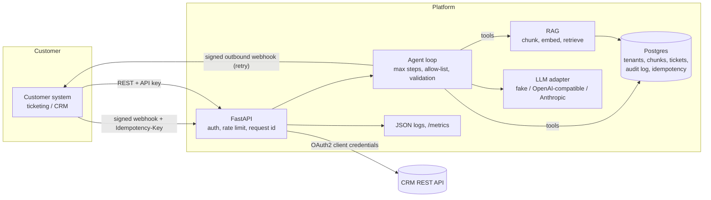

# Agent Integration Platform

A Python service that lets a customer connect their own systems and run an LLM agent over their data.
The demo use case is **support triage**: a ticket arrives by webhook, the agent searches the customer's
knowledge base, and the answer comes back with citations.

This is a portfolio project. It is small on purpose, so one person can read and explain all of it.
See [LEARN.md](LEARN.md) for each concept in plain language, and "Limits" below for what is simplified.

## What it does

- REST API (FastAPI, OpenAPI docs at `/docs`) with per-tenant API keys.
- RAG: ingest markdown, text and PDF; chunk; embed; retrieve; answer with citations.
- Agent loop with tool use: `search_knowledge_base`, `lookup_ticket`, `create_ticket`, `call_customer_webhook`.
- Guardrails: step limit, per-tenant tool allow-list, pydantic validation of input, tool arguments and output
  (an answer may only cite chunks that were really retrieved).
- LLM adapters: deterministic `FakeProvider` (all tests), OpenAI-compatible HTTP (Ollama, vLLM, OpenAI), Anthropic.
- Integrations: inbound webhooks (HMAC + replay window + idempotency keys), outbound webhooks (signed, retry with
  backoff), OAuth2 client-credentials helper, a REST connector to a mock CRM (included).
- Evals: YAML test set, scoring (facts + citations + tool use), versioned prompts, pass-rate report, runs in CI.
- Observability: JSON logs with request ids and trace ids, Prometheus `/metrics`, audit log table.
- Case workflow (`aip.graph`): a LangGraph state graph with typed state: classify, retrieve, propose, check_authority,
  human approval (pauses above a limit, resumes after a restart), act, record. Step and token budgets. A written
  authority file ([docs/engagement/AUTHORITY.md](docs/engagement/AUTHORITY.md)) decides what is refused.
- One constrained write path: an MCP tool server with one tool, `create_return_authorization`.
- Retrieval: one `Retriever` port with a Python cosine store, PostgreSQL pgvector plus full-text search fused by
  reciprocal rank fusion, and Qdrant; access labels so agents never see team lead documents; `/v2/search`.
- Cloud ports: blob, queue and secrets with local adapters and S3, SQS (with a DLQ) and Secrets Manager adapters
  tested against moto. Resilience: timeouts, retry budget, breaker, failover between two providers.
- Operations: OpenTelemetry spans with GenAI attributes, a Redis rate limiter and embedding cache, a Locust test,
  a release manifest with an image digest and an SBOM.
- Ops: multi-stage Dockerfile, docker-compose, Makefile, GitHub Actions, Terraform for AWS (reference only).

## Verified locally

Dates are 2026-11-09. Every command was run on one laptop (MacBook Pro mid 2015, Fedora 44, podman 5.8.7). Numbers marked "measured on one laptop" do not predict production behavior. No GitHub Actions run was started or checked for any of this work.

| Claim | Command | Evidence |
|---|---|---|
| Starting point: 80 tests, 9 of 9 evals | `pytest --cov` and `aip eval run` at the first commit | `docs/engagement/evidence/baseline-local.txt` |
| Case graph pauses for approval and resumes after a restart (SQLite and PostgreSQL) | `pytest tests/test_graph_resume.py tests/test_graph_resume_pg.py` | `graph-resume-after-restart.txt`, `graph-resume-postgres.txt` |
| One MCP write tool, no other write path | `pytest tests/test_mcp_server.py tests/test_graph_write_paths.py` | tests |
| Step and token budgets, written authority and refusals | `pytest tests/test_budgets.py tests/test_authority.py` | tests |
| 62 case evals in replay mode with synthetic cassettes, gate 0.95 | `aip eval run --suite cases --replay --min-pass-rate 0.95` | `eval-cases-replay.txt`, `docs/engagement/EVAL-REPORT.md` |
| Prompt injection in tickets and documents | `pytest tests/test_injection.py` | tests |
| Failover between two providers and switch back (mocked, manual clock) | `pytest tests/test_resilient_provider.py -v` | `llm-failover-test.txt` |
| S3, SQS with a DLQ and redrive, and Secrets Manager adapters against moto | `pytest tests/test_aws_adapters.py tests/test_ingest_queue.py` | `ingest-dlq-redrive.txt` |
| Cloud verifier and teardown against a moto server | `scripts/aws_verify.py`, `scripts/aws_teardown.py --yes`, `--expect-empty` | `aws-verifier-moto.txt`, `aws-teardown-moto.txt` |
| Release manifest with a local image digest, a CycloneDX SBOM and the acceptance gate | `podman build`, `scripts/release_manifest.py`, `scripts/acceptance_gate.py` | `release-local-build.txt`, `release/manifest.json` |
| Security checks (Gitleaks, Bandit, Semgrep, pip-audit, image scan, SBOM) | see `docs/engagement/SECURITY-GATE.md` | `security-gate-local.txt` |
| Migration 0006 up and down on PostgreSQL with pgvector | `pytest -m pg` | `migration-0006-up-down.txt`, `pg-hybrid-tests.txt` |
| Hybrid retrieval on 48 labelled queries: recall@5 0.9659, MRR 0.8557, p50 3.0 ms (measured on one laptop) | `aip eval retrieval --db-url <pg> --embedder local_onnx` | `retrieval-report.md` |
| Qdrant and pgvector tie in vector mode (recall@5 0.9583) | `aip eval retrieval --store qdrant` | `qdrant-vs-pgvector.md` |
| Local ONNX embedder, 384 dimensions | `pytest tests/test_local_onnx_embedder.py` | `local-embedder-check.txt` |
| One Jaeger trace of a case run with GenAI attributes | `scripts/trace_case.sh` | `jaeger-agent-trace.json`, `jaeger-agent-trace.txt` |
| Locust run, 20 users, 2 minutes, 1 079 requests, no failures, 9 requests per second (measured on one laptop, fake model with 200 ms delay) | `scripts/locust_run.sh` | `docs/engagement/LOADTEST.md` |
| Redis rate limiter and embedding cache (second run all hits) | `pytest tests/test_redis_limiter.py tests/test_embed_cache.py` | `embed-cache-hit-ratio.txt` |
| Case run demo from ticket to approved return authorization | `scripts/demo_case.sh` | `demo-transcript.txt` |
| Full gate: ruff, mypy, 304 tests with coverage 94 percent and PostgreSQL, evals 9 of 9 and 62 of 62 | `pytest --cov --cov-fail-under=85` with `AIP_TEST_PG_URL` set | `full-gate-local.txt` |

The index of all evidence files is `docs/engagement/evidence/README.md`.

## Authored, not run

| File | What it would do | Why it did not run |
|---|---|---|
| `infra/aws-engagement/*.tf` and `infra/*.tf` | Create the S3 bucket, queues, secret, IAM user and budget; the older ECS sketch | Authored, not run: written and syntax-checked with python-hcl2. Not executed against AWS. Reason: tool not installed (no terraform or tofu) and no cloud account by design |
| `scripts/aws_verify.py` and `scripts/aws_teardown.py` on real AWS | Check and remove real resources | Authored, not run: tested against moto only. Not executed against real AWS. Reason: no cloud account by design |
| `docker-compose.yml` profile `localstack` | Start LocalStack | Authored, not run: syntax-checked with podman compose. Not executed against LocalStack. Reason: no local run by owner decision. `docker compose config` did not run because the plugin is missing |
| Real hosted model calls (Anthropic Messages API adapter, OpenAI-compatible adapter) | Answer chat requests with a hosted model | Authored, not run: tested with mocked HTTP only. Not executed against a hosted API. Reason: no hosted account or spend cap by design. Cassettes are synthetic |
| `.github/workflows/release.yml` push, cosign signing and SBOM attach | Publish and sign the image | Authored, not run: syntax-checked with actionlint 1.7.12. Not executed. Reason: needs GitHub Actions |
| `.github/workflows/security.yml` CodeQL job and the other new jobs, and the new `ci.yml` steps | Run scans and the Postgres tests on GitHub | Authored, not run: syntax-checked with actionlint. The commands were run locally. Reason: needs GitHub Actions |
| Mermaid diagram in `docs/engagement/ARCHITECTURE.md` | Draw the architecture | Authored, not run: no Mermaid renderer is installed |

## Architecture



The full picture, with the case graph, the MCP tool, the retrieval stores, the cloud ports and the trust boundaries, is in [docs/engagement/ARCHITECTURE.md](docs/engagement/ARCHITECTURE.md).

Code map (`src/aip/`): `api/` routes and middleware, `agent/` loop and tools, `graph/` case workflow, `mcp_server/` the one write tool,
`ports/` blob, queue and secrets, `providers/` LLM adapters, `rag/` chunking and retrieval, `integrations/` webhooks, OAuth, CRM, idempotency, `evals/` harness,
`observability.py`, `security.py`, `models.py`.

## Quick start (local, no Docker, no API keys)

```bash
python3 -m venv .venv && .venv/bin/pip install -e ".[dev]"
export ADMIN_TOKEN=dev-admin
.venv/bin/alembic upgrade head          # creates ./aip.db (SQLite)
.venv/bin/uvicorn --factory aip.api.app:app_factory --port 8000
# open http://localhost:8000/docs
```

Then follow [docs/DEMO.md](docs/DEMO.md). With Docker: `docker compose up --build` (see the demo doc).

## Checks

```bash
make check      # ruff, ruff format, mypy, pytest with coverage, evals
```

Latest local result is in the "Verified locally" section above.

Case evals run the case graph on 62 tickets. They need no network:

```bash
aip eval run --suite cases --replay --min-pass-rate 0.95
```

Cassettes are synthetic. No hosted model response was recorded.

## Release record

A release is described by `release/manifest.json`: git SHA, image digest, Alembic head, config hash, prompt version and hash, eval set hashes and the cassette set hash. `scripts/acceptance_gate.py` checks the manifest and the eval evidence. The compose profile `release` runs the image by digest only.

```bash
podman build -t localhost/agent-integration-platform:dev .
python scripts/release_manifest.py
python scripts/acceptance_gate.py
```

`.github/workflows/release.yml` builds, pushes, signs and attaches an SBOM on a version tag. The workflow is written and not run.

## Choose a real model

```bash
# Ollama or any OpenAI-compatible server
LLM_PROVIDER=openai_compat EMBEDDING_PROVIDER=openai_compat OPENAI_BASE_URL=http://localhost:11434/v1 \
  OPENAI_MODEL=llama3.1 OPENAI_EMBED_MODEL=nomic-embed-text ...
# Anthropic (chat only; embeddings still need openai_compat or fake)
LLM_PROVIDER=anthropic ANTHROPIC_API_KEY=... ANTHROPIC_MODEL=...
```

Keys are read from environment variables only. They are never written to the database, logs or audit rows.

## Limits (honest list)

- On SQLite, vector search loads a tenant's chunks and scores them in Python. Fine for thousands of chunks, not
  millions. On PostgreSQL the pgvector adapter does the search (see ADR 0004).
- Rate limit: a Redis limiter is available. In-memory is the default without `REDIS_URL`, and then it is per process.
- The fake embedding is a hashed bag of words. It matches shared words, not meaning.
- Tenant webhook secrets are stored in the database in plain text (needed to compute HMAC). Use a KMS in production.
- No SSO, no user accounts, no admin UI. See [SECURITY.md](SECURITY.md).

## License

MIT. Copyright (c) 2026 Stanley Sujith Nelavala.
