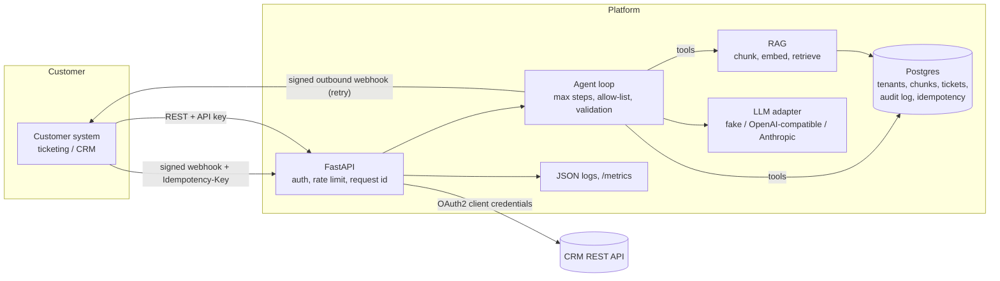

# Agent Integration Platform

A Python service that lets a customer connect their own systems and run an LLM agent over their data.
The demo use case is **support triage**: a ticket arrives by webhook, the agent searches the customer's
knowledge base, and the answer comes back with citations.

This is a portfolio project. It is small on purpose, so one person can read and explain all of it.
See [LEARN.md](LEARN.md) for each concept in plain language, and "Limits" below for what is simplified.

## What it does

- REST API (FastAPI, OpenAPI docs at `/docs`) with per-tenant API keys.
- RAG: ingest markdown, text and PDF; chunk; embed; retrieve; answer with citations.
- Agent loop with tool use: `search_knowledge_base`, `lookup_ticket`, `create_ticket`, `call_customer_webhook`.
- Guardrails: step limit, per-tenant tool allow-list, pydantic validation of input, tool arguments and output
  (an answer may only cite chunks that were really retrieved).
- LLM adapters: deterministic `FakeProvider` (all tests), OpenAI-compatible HTTP (Ollama, vLLM, OpenAI), Anthropic.
- Integrations: inbound webhooks (HMAC + replay window + idempotency keys), outbound webhooks (signed, retry with
  backoff), OAuth2 client-credentials helper, a REST connector to a mock CRM (included).
- Evals: YAML test set, scoring (facts + citations + tool use), versioned prompts, pass-rate report, runs in CI.
- Observability: JSON logs with request ids and trace ids, Prometheus `/metrics`, audit log table.
- Ops: multi-stage Dockerfile, docker-compose, Makefile, GitHub Actions, Terraform for AWS (reference only).

## Architecture



The full picture, with the case graph, the MCP tool, the retrieval stores, the cloud ports and the trust boundaries, is in [docs/engagement/ARCHITECTURE.md](docs/engagement/ARCHITECTURE.md).

Code map (`src/aip/`): `api/` routes and middleware, `agent/` loop and tools, `graph/` case workflow, `mcp_server/` the one write tool,
`ports/` blob, queue and secrets, `providers/` LLM adapters, `rag/` chunking and retrieval, `integrations/` webhooks, OAuth, CRM, idempotency, `evals/` harness,
`observability.py`, `security.py`, `models.py`.

## Quick start (local, no Docker, no API keys)

```bash
python3 -m venv .venv && .venv/bin/pip install -e ".[dev]"
export ADMIN_TOKEN=dev-admin
.venv/bin/alembic upgrade head          # creates ./aip.db (SQLite)
.venv/bin/uvicorn --factory aip.api.app:app_factory --port 8000
# open http://localhost:8000/docs
```

Then follow [docs/DEMO.md](docs/DEMO.md). With Docker: `docker compose up --build` (see the demo doc).

## Checks

```bash
make check      # ruff, ruff format, mypy, pytest with coverage, evals
```

Latest local result is in the "Verified" section below.

Case evals run the case graph on 62 tickets. They need no network:

```bash
aip eval run --suite cases --replay --min-pass-rate 0.95
```

Cassettes are synthetic. No hosted model response was recorded.

## Release record

A release is described by `release/manifest.json`: git SHA, image digest, Alembic head, config hash, prompt version and hash, eval set hashes and the cassette set hash. `scripts/acceptance_gate.py` checks the manifest and the eval evidence. The compose profile `release` runs the image by digest only.

```bash
podman build -t localhost/agent-integration-platform:dev .
python scripts/release_manifest.py
python scripts/acceptance_gate.py
```

`.github/workflows/release.yml` builds, pushes, signs and attaches an SBOM on a version tag. The workflow is written and not run.

## Authored, not run

| File or step | What it would do | Why it did not run |
|---|---|---|
| `.github/workflows/release.yml` push to the registry and cosign signing | Push an image, sign it by digest, attach the SBOM | Authored, not run: this file is written and syntax-checked with actionlint 1.7.12. It was not executed on GitHub. Reason: needs GitHub Actions |
| Real hosted model call (Anthropic Messages API adapter, OpenAI-compatible adapter) | Answer chat requests with a hosted model | Authored, not run: this adapter is tested with mocked HTTP only. It was not executed against a hosted model API. Reason: no hosted account or spend cap by design |

This table grows as the work proceeds.

## Choose a real model

```bash
# Ollama or any OpenAI-compatible server
LLM_PROVIDER=openai_compat EMBEDDING_PROVIDER=openai_compat OPENAI_BASE_URL=http://localhost:11434/v1 \
  OPENAI_MODEL=llama3.1 OPENAI_EMBED_MODEL=nomic-embed-text ...
# Anthropic (chat only; embeddings still need openai_compat or fake)
LLM_PROVIDER=anthropic ANTHROPIC_API_KEY=... ANTHROPIC_MODEL=...
```

Keys are read from environment variables only. They are never written to the database, logs or audit rows.

## Verified (2026-11-07, on the author's machine, Python 3.14 locally)

- `pytest`: 80 passed, 96% line coverage. `ruff check` and `ruff format --check`: clean. `mypy`: no issues (37 files).
- `aip eval run`: 9/9 cases pass with the FakeProvider (this checks the plumbing, not model quality).
- Alembic migration run on SQLite (in the tests) and on a real local PostgreSQL; the API smoke-tested on Postgres.
- Docker image built with podman, container started, `/health` answered, runs as a non-root user.
- `podman-compose config` parses `docker-compose.yml` (`docker compose config` itself was not run: Docker is not installed).
- Real API run with curl: output in [docs/DEMO.md](docs/DEMO.md).

Not verified: calls to real OpenAI-compatible or Anthropic endpoints (adapters tested with mocked HTTP only),
`terraform validate` (Terraform not installed here; CI runs it), the GitHub Actions workflow (never pushed),
`docker compose up` end to end, Python 3.12 (CI uses 3.12; local runs use 3.14).

## Limits (honest list)

- Vector search loads a tenant's chunks and scores them in Python. Fine for thousands of chunks, not millions.
  Replace `SqlCosineStore` with pgvector behind the same interface.
- Rate limit: a Redis limiter is available. In-memory is the default without `REDIS_URL`, and then it is per process.
- The fake embedding is a hashed bag of words. It matches shared words, not meaning.
- Tenant webhook secrets are stored in the database in plain text (needed to compute HMAC). Use a KMS in production.
- No SSO, no user accounts, no admin UI. See [SECURITY.md](SECURITY.md).

## License

MIT. Copyright (c) 2026 Stanley Sujith Nelavala.
