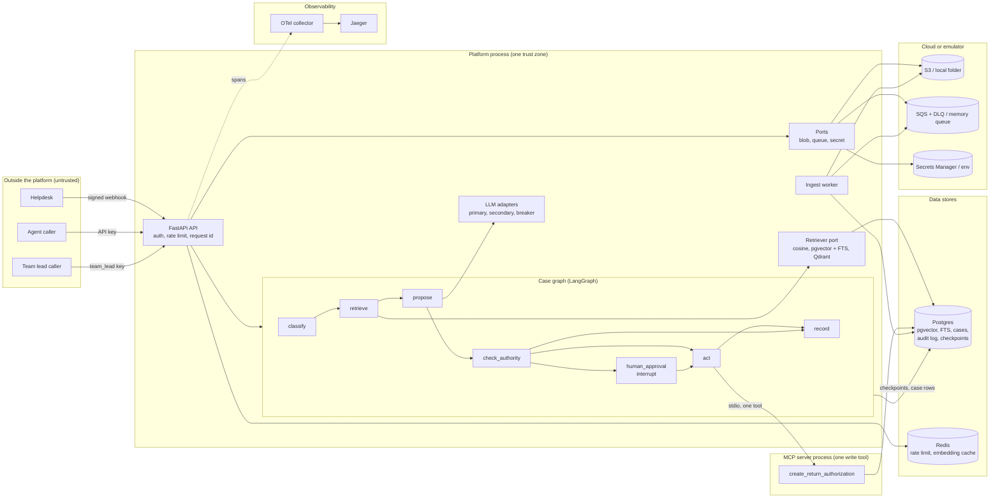

# Architecture

Fictional customer: OutdoorCo. This file shows the parts of the platform and the trust boundaries. Each part has a short text below the diagram.

Diagram status: not rendered locally. No Mermaid renderer is installed and the package cannot be fetched offline. The diagram uses plain flowchart syntax.

## Components

| Part | What it does | Main files |
|---|---|---|
| API | Authenticates callers, applies the rate limit, routes requests, opens one server span per request | `src/aip/api/app.py`, `src/aip/api/routes.py` |
| Case graph | Runs classify, retrieve, propose, check_authority, human_approval, act and record. It pauses for a team lead above the approval limit. | `src/aip/graph/build.py`, `src/aip/graph/nodes.py` |
| Authority file | Written rules that the check_authority node reads | `docs/engagement/AUTHORITY.md`, `src/aip/graph/authority.py` |
| MCP server | The only write path of the graph. One tool, tenant bound at start | `src/aip/mcp_server/server.py` |
| Retriever port | One search interface for the SQL store, Postgres hybrid search and Qdrant | `src/aip/rag/retriever.py`, `src/aip/rag/pg_hybrid.py`, `src/aip/rag/qdrant_store.py` |
| LLM adapters | Fake, OpenAI-compatible and Anthropic Messages API adapters, with timeouts, retry budget, breaker and failover | `src/aip/providers/` |
| Ports | Blob, queue and secret interfaces with local and AWS adapters | `src/aip/ports/` |
| Worker | Reads ingest jobs, fetches text, ingests it, leaves failed jobs for retry and the DLQ | `src/aip/worker.py` |
| Postgres | Holds tenants, documents, chunks (JSON and vector), cases, return authorizations, the append-only audit log and graph checkpoints | `migrations/versions/` |
| Redis | Shared rate limit and embedding cache. Both are optional | `src/aip/security.py`, `src/aip/providers/cache.py` |
| Observability | OpenTelemetry spans with GenAI attributes. Jaeger shows them | `src/aip/observability.py` |

## Trust boundaries

1. **Outside to API.** Helpdesk calls carry an HMAC signature. Other callers send an API key. The key sets the tenant and the role.
2. **API to graph.** The graph gets the tenant and the role from the key, never from the request body.
3. **Graph to LLM.** The model output is data. The graph validates it into a typed proposal. The authority file decides what is allowed.
4. **Graph to MCP server.** One tool, a JSON schema, a hard cap on the amount, and the tenant fixed at start.
5. **Platform to data stores.** Every query filters by tenant. The audit log accepts inserts only.
6. **Platform to cloud.** Adapters take a client and a name. Real AWS would need only new settings.

## Where each decision is recorded

See `docs/engagement/adr/README.md`.
