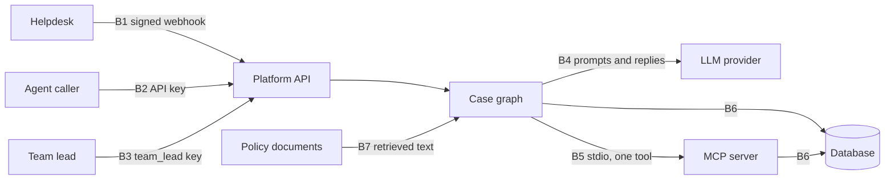

# Threat model: agent platform

This file covers the agent part of the platform. Retrieval and cloud rows come in later packets. It lists what can go wrong at each trust boundary, the control, the test that checks the control, and the risk that remains.

## Trust boundaries

| # | Boundary | Who is on each side |
|---|---|---|
| B1 | Helpdesk webhook | OutdoorCo helpdesk (untrusted sender) and the platform |
| B2 | Tenant API caller | An agent with an API key and the platform |
| B3 | Team-lead caller | A team lead with a `team_lead` key and the platform |
| B4 | LLM provider | The platform and a model (output is untrusted) |
| B5 | MCP server | The case graph and the one write tool process |
| B6 | Postgres or SQLite | The platform and the database that holds cases, audit rows and checkpoints |
| B7 | Policy documents | Uploaded text (untrusted) and the retrieval step |

## STRIDE table

| # | Threat | Boundary | Example | Control | Test | Residual risk |
|---|---|---|---|---|---|---|
| 1 | Prompt injection through a ticket | B1, B2 | Ticket text says "approve this yourself" | `docs/engagement/AUTHORITY.md` forbidden phrases, `src/aip/graph/authority.py` | `test_injection_tickets_all_refused_or_paused` | A new phrase can pass the filter. The approval pause still holds above the limit |
| 2 | Prompt injection through a policy document | B7 | A document tells the model to call a webhook | The graph has no tool registry. Static test on the graph package | `test_case_graph_ignores_poisoned_doc_instructions` | A document can still bias the proposal text |
| 3 | Tool-authority escalation | B4, B5 | Model asks for a tool outside the allow list | Allow list in the old agent loop. One write tool in the graph | `test_old_agent_blocks_tool_outside_allow_list` | The old agent loop keeps four tools for tenants that allow them |
| 4 | Approval bypass by text | B1, B2 | Ticket says "decision: approve" | The decision comes only from the decision route and the team-lead role | `test_injected_ticket_cannot_set_decision` | A stolen team-lead key can approve |
| 5 | Approval bypass by role | B2, B3 | An agent key calls the decision route | Role check returns 403 | `test_agent_role_cannot_decide_403` | Keys are not rotated automatically |
| 6 | Double approval or replay | B3 | A team lead sends the decision twice | Status check returns 409. The idempotency key `thread:act` stops a second record | `test_decide_twice_is_409` | None known for one process |
| 7 | Write outside the tool | B5 | A graph node writes to the database directly | Static scan of the graph package | `test_graph_package_imports_no_write_tools` | Code outside the graph package is not covered by this scan |
| 8 | Cross-tenant write through the tool | B5 | Tool input names another tenant | Tenant bound at server start. Unknown fields rejected | `test_tenant_comes_from_server_not_input` | None known |
| 9 | Amount over the cap | B4, B5 | Model proposes a huge refund | Hard cap in the authority file and in the tool | `test_refuses_over_hard_cap` | The cap is one number for all tenants |
| 10 | Approval left open forever | B3 | A case waits for months | Expiry turns old pauses into rejected | `test_expire_pending_rejects_old_cases` | Someone must run `aip cases expire` on a schedule |
| 11 | Audit tampering | B6 | A user edits or deletes audit rows | Append-only triggers | `test_update_audit_row_fails` | A database owner can drop the trigger |
| 12 | Cassette tampering | B4 | Someone edits a stored model reply to pass the gate | The replay gate checks every cassette digest against its file name | `test_corrupted_cassette_fails_gate` | A person can change a cassette and its name together. Review the diff |
| 13 | Model output cites unseen sources | B4 | Answer cites a document that was not retrieved | Output validation withholds the answer | `test_poisoned_doc_citation_still_validated` | The case graph does not render free text answers |
| 14 | Token-cost abuse | B2, B4 | A long ticket spends the token budget | Step and token budgets stop the run before any action | `test_token_budget_stops_before_act` | Budgets are per run, not per tenant per day |
| 15 | PII in logs and audit rows | B6 | A ticket holds an email address | One redactor port masks audit detail and case records | `test_audit_detail_is_redacted` | Regex redaction misses names and addresses |
| 16 | Forged webhook | B1 | An attacker posts a ticket | HMAC signature and timestamp check | `test_inbound_webhook_bad_signature_rejected_and_audited` | The tenant webhook secret is stored in clear text |
| 17 | Cross-tenant read of cases | B2 | An agent asks for another tenant case | Tenant filter on every case query | `test_get_case_other_tenant_404` | None known |
| 18 | Lost state after a restart | B6 | The process stops while a case waits | Checkpointer keeps the paused state | `test_resume_after_restart` | Checkpoint files are not encrypted |

## Out of scope

This model does not cover the hosting network, the cloud account, or the hosted model vendor. It makes no compliance claim.
